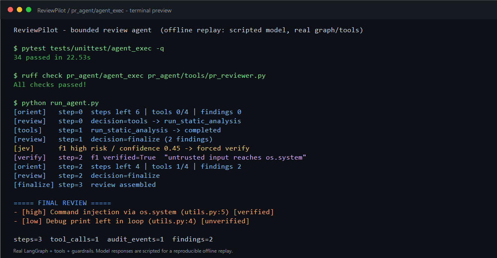
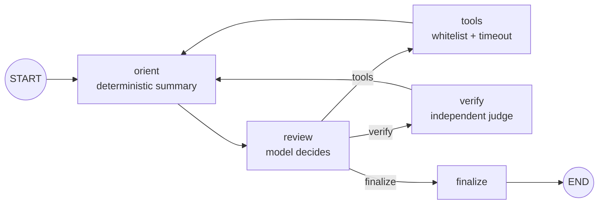

# ReviewPilot

**A bounded, auditable AI code-review agent — built on top of [PR-Agent](https://github.com/qodo-ai/pr-agent).**

English · [简体中文](README.zh-CN.md)



> The preview shows a reproducible offline replay: the real LangGraph, tools and
> guardrails run end-to-end, while the model replies are scripted.

---

## What this is

PR-Agent already ships a strong single-shot review pipeline. ReviewPilot adds a
**bounded agent loop** on top of it: the model can inspect the diff, call
read-only tools, verify its own high-risk findings, and only then publish a
review. Every step is recorded, and every limit is enforced by the harness —
not by the prompt.

The loop is **opt-in**. With `[agent_exec].enabled = false` (the default),
`/review` behaves exactly like upstream PR-Agent.

## Highlights

| Capability | Where it lives |
|---|---|
| OODA agent loop (`orient → review → tools/verify → finalize`) | `pr_agent/agent_exec/graph.py` |
| Server-enforced step / tool-call / token budgets | `pr_agent/agent_exec/policy.py` |
| Loop detection (repeated decisions force finalize) | `pr_agent/agent_exec/nodes.py` |
| Jev rule: high-risk + low-confidence findings must be verified | `pr_agent/agent_exec/nodes.py` |
| Independent LLM verification (LLM-as-Judge) | `pr_agent/agent_exec/nodes.py::verify_node` |
| Structured, replayable trajectory + audit events | `pr_agent/agent_exec/models.py` |
| Read-only tool whitelist with per-tool timeout | `pr_agent/agent_exec/tools/` |
| MCP-style tool descriptors + external tool adapter | `pr_agent/agent_exec/tools/base.py` |
| Multi-sub-agent fan-out with deterministic merge | `pr_agent/agent_exec/federation.py` |
| Reproducible benchmark harness (precision / recall / completion) | `pr_agent/agent_exec/benchmark.py` |
| `/review` integration behind a feature flag | `pr_agent/tools/pr_reviewer.py` |

## Architecture



The model can only choose between three actions: `tools`, `verify`, `finalize`.
The harness may override that choice when a budget is exhausted, a loop is
detected, or a finding needs verification.

## Quick start

```bash
# Python >= 3.12 and uv >= 0.12.10
uv sync

# Configure secrets
cp pr_agent/settings/.secrets_template.toml pr_agent/settings/.secrets.toml
# fill [openai] key and [github] user_token

# Run a normal review
PYTHONPATH=. uv run pr-agent --pr_url=https://github.com/owner/repo/pull/1 review

# Review a local diff without a PR
PYTHONPATH=. uv run pr-agent --diff-file=changes.patch --output=result.md review
```

Enable the ReviewPilot agent (repo-level `.pr_agent.toml`):

```toml
[agent_exec]
enabled = true
```

Or via environment variable:

```bash
export AGENT_EXEC__ENABLED=true
```

With the flag on, `/review` routes to `ReviewAgentRunner` and publishes its
`final_answer`; with it off, the original pipeline runs untouched.

For a standalone loop run (no PR, no published comment):

```bash
PYTHONPATH=. uv run python run_agent.py
```

## How a run is controlled

| Node | OODA phase | Responsibility |
|---|---|---|
| `orient` | Orient | Deterministic environment summary: steps left, tool budget, current findings, decision history. No LLM call. |
| `review` | Observe + Decide | Model returns JSON: `tools` / `verify` / `finalize`, plus findings on finalize. |
| `tools` | Act | Executes one whitelisted tool under a timeout; records an audit event. |
| `verify` | Act | Independent review pass on one targeted finding. |
| `finalize` | — | Renders the final review text. |

Guardrails applied in server code:

- `max_steps` — hard cap on decision iterations.
- `max_tool_calls` — hard cap on tool executions.
- `tool_timeout_seconds` — per-tool timeout.
- `loop_detection_window` — N identical consecutive decisions force finalize.
- `enforce_tool_whitelist` — unregistered tools are refused, not executed.

### Jev: verification before finalize

Jev is not a separate model or classifier. It is a **harness rule plus an
independent LLM pass**:

1. The model proposes `finalize`.
2. The harness scans the merged findings. If any finding is `risk_level=high`,
   `confidence < verify_confidence_threshold` (default `0.6`) and
   `verified is None`, the decision is rewritten to `verify`.
3. The graph routes to `verify`, which calls the model again with a different
   system prompt (`"You are an independent reviewer."`) and records
   `verified` / `verification_note` on the finding.
4. The loop returns to `orient → review`. A verified finding no longer triggers
   Jev, so the next `finalize` succeeds. Refuted findings stay in the output,
   marked `[refuted]`.

The gate uses **`Finding.confidence`**, not `Decision.confidence`. Verification
is bounded by `max_steps`, so it cannot loop forever.

## Multiple sub-agents

`ReviewerFederation` partitions diff files into batches and runs one bounded
agent per batch concurrently, then merges findings deterministically:

```python
from pr_agent.agent_exec.federation import ReviewerFederation

findings = await ReviewerFederation().review(diff_files, max_files_per_batch=1)
```

Duplicates are collapsed by `(file_path, title, line, risk)`, and a verification
verdict produced by any sub-agent is carried onto the merged record.

## Benchmark

`BenchmarkRunner` scores a dataset of PRs with ground-truth labels and reports
precision, recall, completion rate, average tool calls, steps and token
estimates, plus a weighted score.

```python
import asyncio
from pr_agent.agent_exec.benchmark import BenchmarkRunner, load_dataset
from pr_agent.agent_exec.runner import ReviewAgentRunner

async def main():
    items = load_dataset("benchmark/prs.json")
    report = await BenchmarkRunner(runner_factory=ReviewAgentRunner).run(items)
    print(report.as_dict())

asyncio.run(main())
```

A finding matches ground truth when `file_path` and `line_number` are equal and
the title token overlap (Jaccard) is at least `0.5`.

> The harness is shipped; the published precision/recall numbers depend on the
> dataset and the model you run. No benchmark numbers are claimed in this README.

## Tests

```bash
PYTHONPATH=. uv run pytest tests/unittest/agent_exec -q   # 34 passed
uv run ruff check pr_agent/agent_exec pr_agent/tools/pr_reviewer.py tests/unittest/agent_exec
```

Current state of this repository: **34 agent tests passing**, ruff clean.

## Project layout

```
pr_agent/agent_exec/
├── runner.py        # bounded loop entry point
├── graph.py         # LangGraph state machine
├── nodes.py         # orient / review / tools / verify / finalize + guardrails
├── policy.py        # budgets, timeout, verification threshold
├── models.py        # Finding / Decision / TrajectoryStep / AuditEvent
├── llm.py           # reuse of LiteLLMAIHandler
├── federation.py    # multi-sub-agent fan-out + merge
├── benchmark.py     # reproducible scoring harness
└── tools/
    ├── base.py      # protocol, registry, MCP descriptors/adapters
    ├── read_file_context.py
    ├── find_references.py
    └── run_static_analysis.py
tests/unittest/agent_exec/
├── test_agent_exec.py
├── test_agent_review_wiring.py
├── test_mcp_tools.py
├── test_federation.py
└── test_benchmark.py
```

## Configuration

Defaults live in `pr_agent/settings/configuration.toml`:

```toml
[agent_exec]
enabled = false
max_steps = 6
max_tool_calls = 4
max_tokens = 20000
tool_timeout_seconds = 10.0
verify_confidence_threshold = 0.6
loop_detection_window = 3
enforce_tool_whitelist = true
```

Override per repository in `.pr_agent.toml`, or globally with environment
variables such as `AGENT_EXEC__ENABLED=true`.

## Documentation

- [Full startup and operations guide (中文)](docs/md/项目启动运行说明.md)
- [Implementation checklist and resume cross-check (中文)](docs/md/技术实现清单与简历核对.md)

## Credits

ReviewPilot builds on [PR-Agent](https://github.com/qodo-ai/pr-agent) by Qodo.
Provider integrations, prompting infrastructure, configuration system and CLI
come from upstream. The agent loop, guardrails, federation and benchmark layers
are added in `pr_agent/agent_exec/`.

## License

Apache 2.0 — see [LICENSE](LICENSE).
