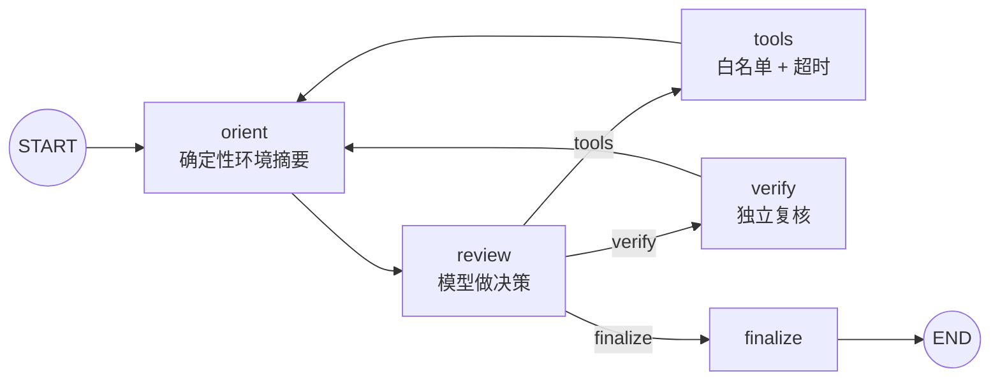

# ReviewPilot

**一个有界、可审计的 AI 代码评审 Agent —— 输入任意 Pull Request，输出经过复核、全程可追溯的评审结果。**

[English](README.md) · 简体中文


> 预览图来自一次可复现的离线回放：真实的 LangGraph、工具与护栏完整执行，模型回复由脚本给出。

---

## 项目简介

ReviewPilot 是一个面向 Pull Request 的 AI 代码评审 Agent。指向一个 PR，它会检查 diff、调用只读工具收集上下文、用独立的复核环节验证自己的高风险结论，最后发布结构化的评审评论。支持 GitHub、GitLab、Bitbucket、Azure DevOps、Gitea、Gerrit 以及纯 diff 输入，可通过 CLI 或 Webhook 服务运行。

评审在一个**有界 Agent 循环**（OODA）中进行：每一步由模型观察环境并决定下一个动作，同时 Harness（服务端代码）对步数、工具调用次数、Token 和超时实施硬性限制。每一步都会记录为结构化、可回放的 Trajectory 与审计事件。

该循环是**可选的**。`[agent_exec].enabled = false`（默认值）时，`/review` 走单次审查管线；设为 `true` 后完整 Agent 循环接管。

## 能力一览

| 能力 | 实现位置 |
|---|---|
| OODA Agent 循环（`orient → review → tools/verify → finalize`） | `pr_agent/agent_exec/graph.py` |
| 步数 / 工具调用 / Token 预算（服务端强制） | `pr_agent/agent_exec/policy.py` |
| 循环检测（连续相同决策强制收尾） | `pr_agent/agent_exec/nodes.py` |
| Jev 规则：高风险 + 低置信度必须复核 | `pr_agent/agent_exec/nodes.py` |
| 独立 LLM 复核（LLM-as-Judge） | `pr_agent/agent_exec/nodes.py::verify_node` |
| 结构化、可回放的 Trajectory 与审计事件 | `pr_agent/agent_exec/models.py` |
| 只读工具白名单 + 单工具超时 | `pr_agent/agent_exec/tools/` |
| MCP 风格工具描述 + 外部工具适配器 | `pr_agent/agent_exec/tools/base.py` |
| 多 Sub-agent 扇出 + 确定性合并 | `pr_agent/agent_exec/federation.py` |
| 可复现 Benchmark（Precision / Recall / Completion） | `pr_agent/agent_exec/benchmark.py` |
| `/review` 集成（开关控制） | `pr_agent/tools/pr_reviewer.py` |

## 架构



模型只能在三种动作中选择：`tools`、`verify`、`finalize`。当预算耗尽、检测到循环，或某个 finding 需要复核时，Harness 可以覆盖模型的选择。

## 快速开始

一键运行（Windows）：`.\start.ps1` 会自动检查环境、按需创建虚拟环境与密钥文件，并对示例 diff 跑一次真实 Agent 评审。`.\start.ps1 -Test` 运行单元测试，`.\start.ps1 -CheckOnly` 仅检查环境。也可直接双击 `start.bat`。

手动步骤：

```bash
# 需要 Python >= 3.12、uv >= 0.12.10
uv sync

# 配置密钥
cp pr_agent/settings/.secrets_template.toml pr_agent/settings/.secrets.toml

# 选择模型，例如 DeepSeek（支持任意 LiteLLM 兼容的 provider）。
# 在 pr_agent/settings/.secrets.toml 中：
#   [config]
#   model = "deepseek/deepseek-chat"
#   [deepseek]
#   key = "sk-..."   # 从 https://platform.deepseek.com 获取

# 正常审查一个 PR
PYTHONPATH=. uv run pr-agent --pr_url=https://github.com/owner/repo/pull/1 review

# 只审查本地 diff，不发布评论
PYTHONPATH=. uv run pr-agent --diff-file=changes.patch --output=result.md review
```

启用 ReviewPilot Agent（仓库级 `.pr_agent.toml`）：

```toml
[agent_exec]
enabled = true
```

或使用环境变量：

```bash
export AGENT_EXEC__ENABLED=true
```

开启后，`/review` 会改走 `ReviewAgentRunner` 并发布它的 `final_answer`；关闭时原管线完全不受影响。

独立运行一次 Agent 循环（不经过 PR、不发布评论）：

```bash
PYTHONPATH=. uv run python run_agent.py
```

## 一次运行如何被约束

| 节点 | OODA 阶段 | 职责 |
|---|---|---|
| `orient` | Orient | 确定性地总结环境：剩余步数、工具预算、已有 findings、决策历史。不调用模型。 |
| `review` | Observe + Decide | 模型返回 JSON：`tools` / `verify` / `finalize`；finalize 时附带 findings。 |
| `tools` | Act | 在超时约束下执行一个白名单工具，并记录审计事件。 |
| `verify` | Act | 对指定 finding 做一次独立复核。 |
| `finalize` | — | 生成最终评审文本。 |

由服务端代码强制执行的护栏：

- `max_steps` —— 决策迭代硬上限。
- `max_tool_calls` —— 工具执行次数硬上限。
- `tool_timeout_seconds` —— 单工具超时。
- `loop_detection_window` —— 连续 N 次相同决策强制收尾。
- `enforce_tool_whitelist` —— 未注册工具直接拒绝，不会执行。

### Jev：先复核，再定稿

Jev 不是独立模型，也不是分类器，而是**Harness 规则 + 一次独立 LLM 复核**：

1. 模型提出 `finalize`。
2. Harness 扫描合并后的 findings。若某个 finding 同时满足 `risk_level=high`、`confidence < verify_confidence_threshold`（默认 `0.6`）、`verified is None`，就把决策改写为 `verify`。
3. 图路由到 `verify`，用另一套 system prompt（`"You are an independent reviewer."`）再调用一次模型，并把 `verified` / `verification_note` 写回该 finding。
4. 循环回到 `orient → review`。已复核的 finding 不再触发 Jev，下一次 `finalize` 即可通过。被推翻的 finding 仍保留在输出中，标记为 `[refuted]`。

门控使用的是 **`Finding.confidence`**，而不是 `Decision.confidence`。复核受 `max_steps` 约束，不会无限循环。

## 多 Sub-agent 协作

`ReviewerFederation` 把 diff 文件切分成批次，为每个批次并发运行一个有界 Agent，再确定性合并结果：

```python
from pr_agent.agent_exec.federation import ReviewerFederation

findings = await ReviewerFederation().review(diff_files, max_files_per_batch=1)
```

重复项按 `(file_path, title, line, risk)` 去重；任一子 Agent 产出的复核结论会被保留到合并后的记录上。

## Benchmark 评测

`BenchmarkRunner` 对带 ground-truth 的 PR 数据集打分，输出 Precision、Recall、完成率、平均工具调用次数、平均步数、Token 估算以及加权总分。

```python
import asyncio
from pr_agent.agent_exec.benchmark import BenchmarkRunner, load_dataset
from pr_agent.agent_exec.runner import ReviewAgentRunner

async def main():
    items = load_dataset("benchmark/prs.json")
    report = await BenchmarkRunner(runner_factory=ReviewAgentRunner).run(items)
    print(report.as_dict())

asyncio.run(main())
```

匹配规则：`file_path` 与 `line_number` 相同，且标题的 token Jaccard 相似度 ≥ `0.5`。

> 框架已落地，但具体 Precision / Recall 取决于你使用的数据集与模型，本 README 不宣称任何未实测的数字。

## 测试

```bash
PYTHONPATH=. uv run pytest tests/unittest/agent_exec -q   # 34 passed
uv run ruff check pr_agent/agent_exec pr_agent/tools/pr_reviewer.py tests/unittest/agent_exec
```

当前状态：**Agent 相关单测 34 项全部通过**，ruff 检查通过。

## 目录结构

```
pr_agent/agent_exec/
├── runner.py        # 有界循环入口
├── graph.py         # LangGraph 状态机
├── nodes.py         # orient / review / tools / verify / finalize + 护栏
├── policy.py        # 预算、超时、复核阈值
├── models.py        # Finding / Decision / TrajectoryStep / AuditEvent
├── llm.py           # 复用 LiteLLMAIHandler
├── federation.py    # 多 Sub-agent 扇出与合并
├── benchmark.py     # 可复现评分框架
└── tools/
    ├── base.py      # 协议、注册表、MCP 描述/适配
    ├── read_file_context.py
    ├── find_references.py
    └── run_static_analysis.py
tests/unittest/agent_exec/
├── test_agent_exec.py
├── test_agent_review_wiring.py
├── test_mcp_tools.py
├── test_federation.py
└── test_benchmark.py
```

## 配置

默认值位于 `pr_agent/settings/configuration.toml`：

```toml
[agent_exec]
enabled = false
max_steps = 6
max_tool_calls = 4
max_tokens = 20000
tool_timeout_seconds = 10.0
verify_confidence_threshold = 0.6
loop_detection_window = 3
enforce_tool_whitelist = true
```

可在仓库级 `.pr_agent.toml` 覆盖，或用环境变量（如 `AGENT_EXEC__ENABLED=true`）全局覆盖。

## 文档

- [完整启动运行说明](docs/md/项目启动运行说明.md)
- [技术实现清单与简历核对](docs/md/技术实现清单与简历核对.md)

## 许可证

Apache 2.0，详见 [LICENSE](LICENSE)。
